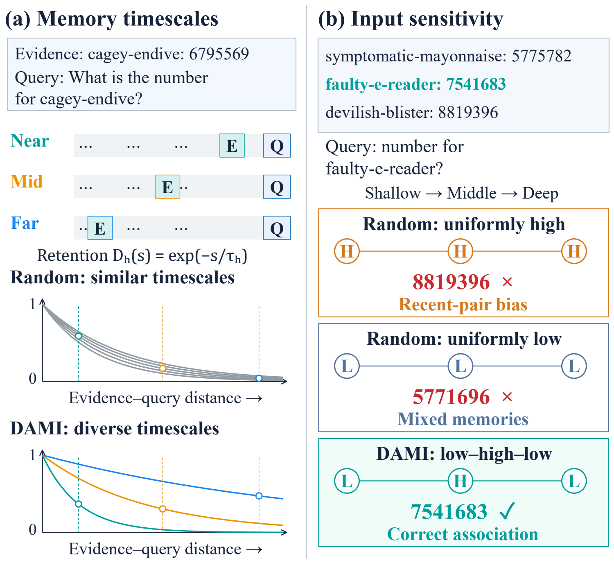
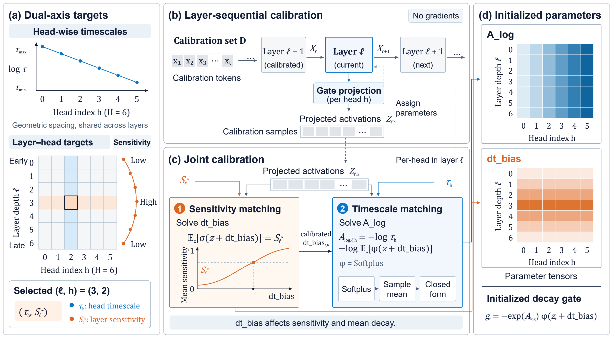
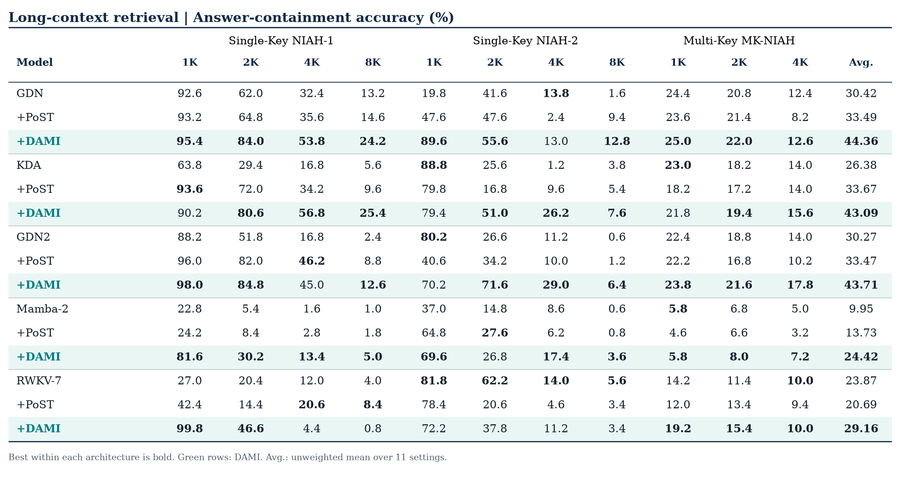

# DAMI

**Dual-Axis Memory Initialization for Enhanced Long-Context Retrieval in Gated Linear Attention**

Zhangchi Feng · Harry Jiang · Yangyifei Luo · Ray Zhang · Richong Zhang

[Project page](https://speedai.com/research/dami) · [Training](#training) · [Evaluation](#ruler-evaluation) · [Results](#ruler-results)

DAMI allocates memory timescales across heads and input responses across layers to improve long-context retrieval. This repository supports all **15 combinations** of GDN / KDA / GDN2 / Mamba-2 / RWKV-7 and Random / PoST / DAMI through one training entry point.

<p align="center"></p>

<p align="center"></p>

## Installation

Use Python 3.12 and Linux/WSL with an NVIDIA CUDA GPU. Install the appropriate PyTorch 2.9 CUDA wheel first, then:

```bash
pip install setuptools wheel packaging ninja
pip install --no-build-isolation -r requirements.txt
```

Model implementations and kernels come from FLA and Mamba; the training loop uses Transformers Trainer. CUDA build tools may be needed when compatible wheels are unavailable.

## Training

Select an architecture and initialization:

```bash
python train.py --architecture gdn --initialization dami \
  --train-files '/data/train-*.parquet' --tokenizer TinyLlama/TinyLlama_v1.1 \
  --output-dir outputs/gdn/dami
```

- `--architecture`: `gdn`, `kda`, `gdn2`, `mamba2`, `rwkv7`.
- `--initialization`: `random`, `post`, `dami`.

Run all 15 paper presets sequentially, with separate output directories:

```bash
python train.py --all \
  --train-files '/data/train-*.parquet' --tokenizer TinyLlama/TinyLlama_v1.1 \
  --output-dir outputs/main
```

Defaults: approximately 100M parameters, 4096-token context, global batch 128, and 9537 steps (approximately 5B tokens per run). The training seed is 42 except for RWKV-7 + DAMI, which uses 43. `--all --dry-run` previews the matrix. Set `CUDA_VISIBLE_DEVICES` to select a GPU; use `torchrun` for distributed training of an individual combination. PoST denotes the paper's spectral-only control.

The original experiments used FLAME; these training entry points use Transformers Trainer. Paper initialization parameters, fixed evaluation data, and recorded predictions are included.

## RULER evaluation

Included: **5,500 fixed samples** across 11 task/length settings and **82,500 original predictions** from the 15 paper checkpoints. Checkpoints are supplied separately in directories such as `main_gdn_random`, `main_gdn_PoST`, and `main_gdn_DAMI`.

Check the downloaded models without running inference (Windows/CPU supported):

```powershell
python evaluate_ruler.py --preflight --all --models-root "D:\Downloads\15"
```

Recompute the original main table without models or a GPU:

```bash
python evaluate_ruler.py --rescore-reference --all --output-dir outputs/ruler-reference
```

Re-run all 15 checkpoints in Linux/WSL with CUDA:

```bash
python evaluate_ruler.py --all --models-root /mnt/d/Downloads/15 \
  --output-dir outputs/ruler-retest --skip-done
```

Use `--architecture` and `--initialization` to evaluate one combination. The evaluator preserves the original prompts and uses greedy bf16 decoding with 128 new tokens and the original batch sizes. It saves predictions, `ruler_results.csv`, and `comparison.json`. Reference rescoring matches **165/165** recorded cells; fresh checkpoint inference is left to the user. Optional `--check-weight-hashes` verifies the complete checkpoint SHA-256 hashes.

## RULER results

All models are approximately 100M parameters and trained for 5B tokens. DAMI improves average retrieval accuracy over Random by **13.95 / 16.71 / 13.44 / 14.47 / 5.29 percentage points** for GDN / KDA / GDN2 / Mamba-2 / RWKV-7.



NIAH-1/2 use 1K, 2K, 4K, and 8K contexts; MK-NIAH uses 1K, 2K, and 4K. Each setting has 500 samples. Scores use case-insensitive answer containment, and Avg. weights all 11 settings equally. Numeric results are available in `assets/retrieval.csv`.

## Citation

```bibtex
@misc{feng2026dami,
  title={DAMI: Dual-Axis Memory Initialization for Enhanced Long-Context Retrieval in Gated Linear Attention},
  author={Feng, Zhangchi and Jiang, Harry and Luo, Yangyifei and Zhang, Ray and Zhang, Richong},
  year={2026},
  url={https://speedai.com/research/dami}
}
```

Built on [FLA](https://github.com/fla-org/flash-linear-attention), [FLAME](https://github.com/fla-org/flame), [Transformers](https://github.com/huggingface/transformers), and [RULER](https://github.com/NVIDIA/RULER). Original repository code uses the [MIT License](LICENSE); benchmark attribution is in [data/ruler/NOTICE.md](data/ruler/NOTICE.md).
